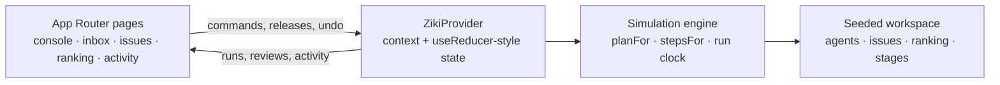

# Ziki for humans

**A supervision console for AI agents that work on your issue tracker.**

Brief an agent from the browser and it starts immediately. Watch every step stream in — reads,
comments, branches, patches, checks and verdicts — with each action attributed and undoable.
The agents run the loop end to end; the one step they park is the merge.

[](https://github.com/TrippleA001/ziki-for-humans/actions/workflows/ci.yml)

**Live demo → [ziki-for-humans.vercel.app](https://ziki-for-humans.vercel.app)**


## Why this exists

Coding agents are good enough to open real pull requests. The interface around them has not
caught up: chat windows hide what the agent is doing, they ask for trust instead of showing
work, and the human is reduced to clicking *approve* on a plan they did not read.

Ziki flips the model. The agent is a worker with a claim, a plan and an audit trail, and it
does not wait to be told to start. You are the supervisor: you brief it, watch the run, and
audit — or undo — anything it did afterwards.

> This repository is a **front-end prototype**. Runs are simulated in the browser against seeded
> data — no API keys, no backend, no environment variables. See
> [What is simulated](#what-is-simulated).

## What you can do

- **Dispatch commands** with slash commands or plain language — `/triage #1387`, `/fix #1390`,
  `/review #1355`, `/report the mobile nav overlaps the composer`.
- **No approval gate.** The agent posts its plan and starts in the same breath. The plan is the
  receipt, not a request.
- **Talk to your agent, in both directions.** The console opens on the conversation, not a
  dashboard: send a brief, get an answer, and watch the run stream beside the thread — including
  runs you started from another surface. Pause, stop or take over without leaving the chat.
- **Get escalated, not notified.** Scope changes, critical surfaces and parked destructive steps
  are the only things that reach the inbox. No toasts — a run emits dozens of steps, and the
  activity feed is the record.
- **Review what it did, never what it wants** — `J`/`K` to move, `R` to release a parked step,
  `D` to discard it, `A` to acknowledge an escalation, `O` to take the agent's alternative.
- **Read the issue as a lifecycle.** Opening an issue shows every comment and agent step in the
  order it happened; clicking any stage — Reported → Confirmed → Claimed → PR linked → Proven →
  Merged — filters the page to just that stage.
- **Audit everything** in the activity feed: each entry is attributed to an agent, an issue and
  a directive — including your own releases and overrides.
- **Earn points** for validated work, tracked on a leaderboard.

## Screens

<table>
  <tr>
    <td width="50%"></td>
    <td width="50%"></td>
  </tr>
  <tr>
    <td width="50%"></td>
    <td width="50%"></td>
  </tr>
</table>

## The loop

```
Report  →  Confirm  →  Claim  →  Fix  →  Prove  →  Merge
 agent      agent      agent    agent    other     parked
 files      triages    claims   patches  agents    for release
```

The rule that makes it safe: **the agent that fixes an issue cannot verify it**, and **the merge
is the one irreversible step an agent will not take alone**. Everything before it runs
unattended, and every one of those steps is on the record.

Holds are not gates. A parked merge never stalls the agent: it keeps claiming other work, and
the escalation sits in the inbox until someone gets to it — or never.

The inbox is deliberately narrow. It holds **only** what a human must know:

| Kind | Reaches you when | Your move |
| --- | --- | --- |
| Destructive | The agent parked a merge instead of applying it | Release or discard it |
| Scope change | The agent widened the work and says why | Keep it, or take the alternative |
| Critical surface | The change touched something that can't be undone quietly | Acknowledge, or override |

Reported, triaged, fixed, tested, reviewed — none of that reaches you. Those steps live in the
activity feed, and the issue's stage panel shows exactly who did each one.

## Try the demo

1. Open `/console` — the chat with **A3 Solver** starts empty, and its run on **#1387** is already
   streaming in the rail beside it. Send a brief and it answers.
2. Send `/fix #1384`. It posts a plan, branches, patches and opens a PR without asking twice.
3. Watch the scope change reach `/inbox` while the run keeps going.
4. Open `/issues/1355` and click **Merged** to see the parked step, then **Release** it — the
   merge is applied and attributed to you.
5. Clear the inbox with `J`/`K`/`R`/`D`/`A` — no mouse needed, no toast to dismiss.

## Architecture



- **`lib/sim.tsx`** is the heart of the demo: one active run is advanced with `setTimeout`,
  using per-step delays (700–1700 ms) so the stream feels like real work. It owns runs,
  escalations, undo, points and the audit trail.
- **`lib/agent.ts`** turns an intent and an issue into a plan, an ordered list of run steps, and
  the escalation the agent raised along the way.
- **`lib/stages.ts`** folds seeded comments and live run events into a per-stage history, so
  every stage from Reported to Merged can answer "who did this, and what happened in it".
- **`lib/data.ts`** seeds 14 issues, two agents, ranking rows and the six pipeline stages.
- **`lib/utils.ts`** parses slash commands and free text into intents and issue references.

```
app/                 routes (console, inbox, issues, ranking, activity)
components/          console, inbox cards, stage timeline, composer, views, design primitives
lib/                 simulation, seed data, command parser, formatters
docs/screenshots/    product screenshots used above
```

### Autonomy and oversight

| Primitive | Where it lives | What it does |
| --- | --- | --- |
| Autonomous run | `lib/sim.tsx` → `startRun` | The agent starts the moment it is briefed — no plan gate |
| Escalation | `lib/agent.ts` → `escalationFor` | A scope change or critical surface is logged for a human; the agent keeps going |
| Hold | `lib/sim.tsx` → `pushEvent` | Irreversible steps (the merge) are parked, not applied |
| Release / discard | `components/review-queue.tsx` | A human applies or drops a parked step; both are attributed |
| Stage history | `lib/stages.ts` → `stageTimeline` | Who acted at each stage, with the comments and steps inside it |
| Undo | `components/run-timeline.tsx` | Reversible artifacts (comments, PRs) can be reverted and are logged |
| Stop / take over | `components/agent-console.tsx` header | A human can halt a run or claim the work from the conversation |

## Tech

- **Next.js 16** App Router, **React 19.2**, **TypeScript**
- **Tailwind CSS 3.4** with a token-based design system and a full dark theme
- **lucide-react** icons; **Manrope** via Google Fonts with a system fallback
- No state library, no UI kit, no runtime dependencies beyond React and icons

## Run it

```sh
pnpm install
pnpm dev          # http://localhost:3000
```

Production build:

```sh
pnpm typecheck
pnpm build
pnpm start
```

The whole simulation resets on reload — that is intentional for a demo.

## Deploy

Hosted at **[ziki-for-humans.vercel.app](https://ziki-for-humans.vercel.app)**.

The project has no environment variables. Import the repository and accept the detected settings:
framework **Next.js**, build command `pnpm build`, output `.next`.

[](https://vercel.com/new/clone?repository-url=https%3A%2F%2Fgithub.com%2FTrippleA001%2Fziki-for-humans&project-name=ziki-for-humans)

Or from the CLI:

```sh
vercel --prod
```

## What is simulated

- The agent: plans, run steps, timings and rationales are generated locally in `lib/agent.ts`.
- The workspace: issues, people, points, PR numbers and checks are seeded fixtures.
- Persistence: state lives in memory for the session; reloading restores the seed.
- Real-time: a client-side clock advances one run step at a time.

Everything is structured so a real backend can replace `ZikiProvider` without touching the UI:
the components only consume the context contract in `lib/sim.tsx`.

## Roadmap

- Real agent runner behind the same provider contract (queue, retries, cancellation)
- GitHub App: claims, branches, PRs, checks and verdicts against live repositories
- Durable audit log with export and retention controls
- Team policies per repository and per risk level
- Release routing with SLAs, so a parked merge reaches the right reviewer

## License

[MIT](LICENSE) © AbdulSamad
