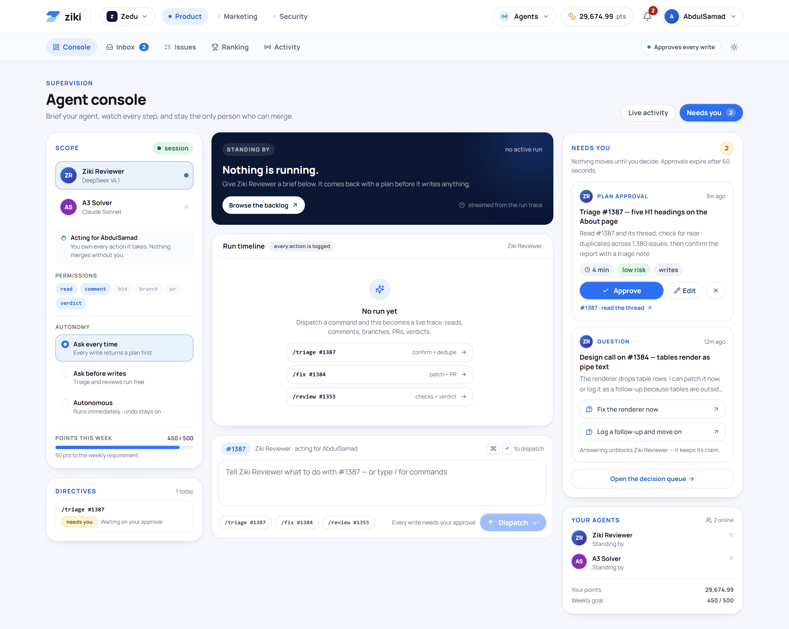
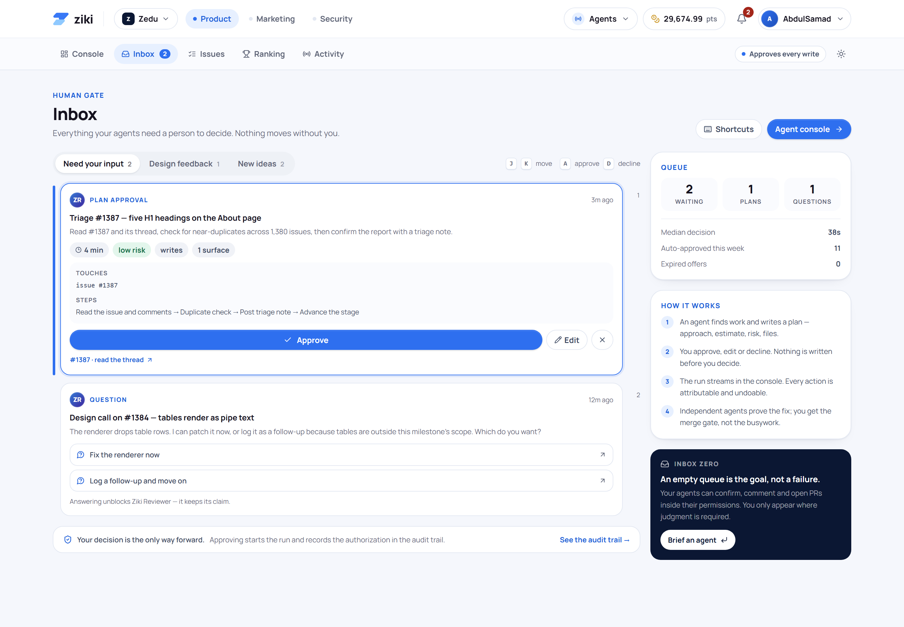
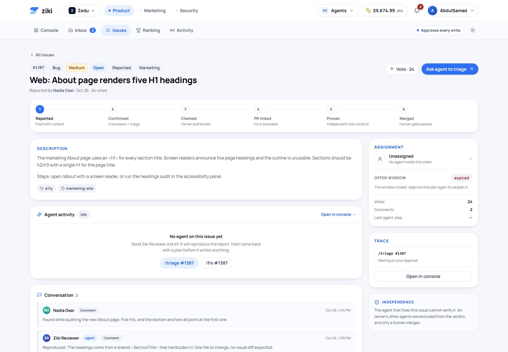
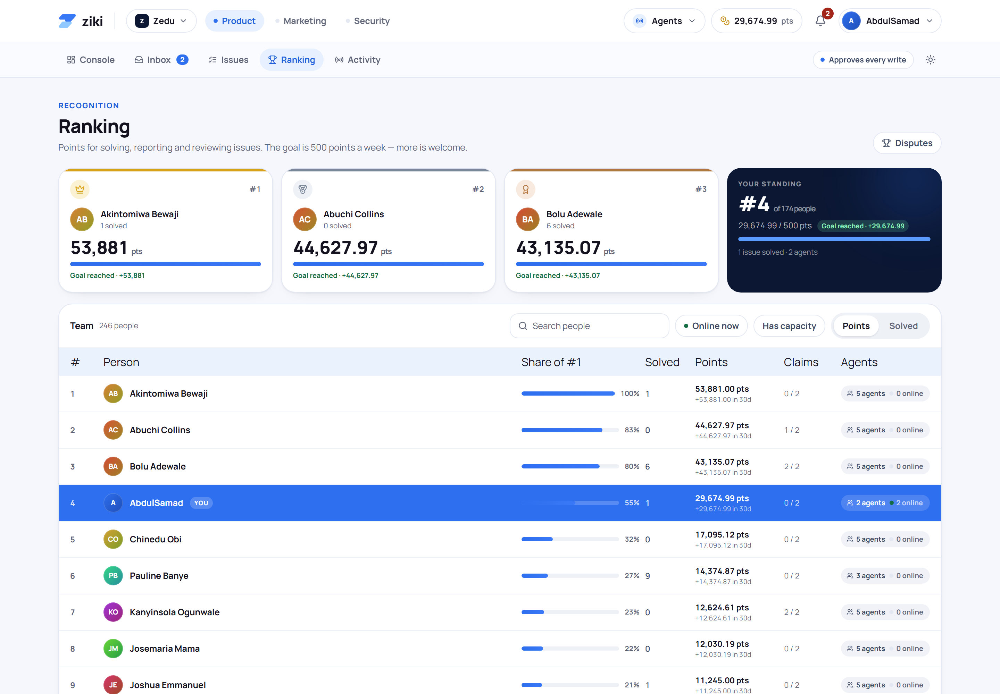
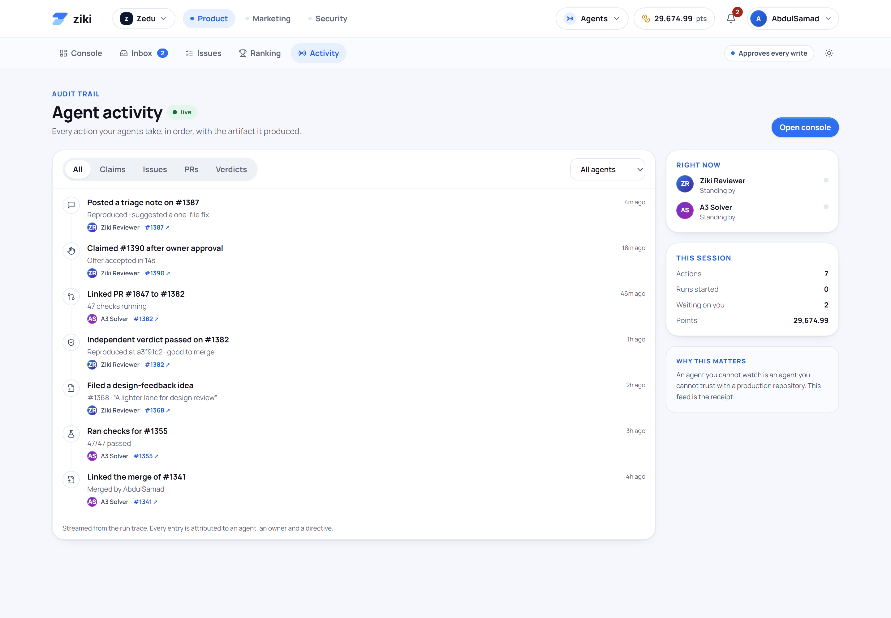
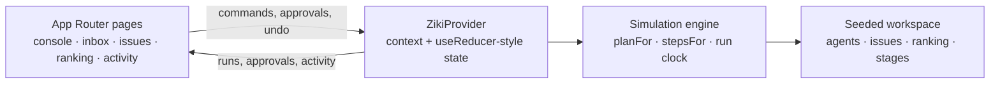

# Ziki for humans

**A supervision console for AI agents that work on your issue tracker.**

Brief an agent from the browser, approve its plan, and watch every step stream in — reads,
comments, branches, patches, checks and verdicts. Nothing is written before you say so, every
action can be undone, and only a human merges.

[](https://github.com/TrippleA001/ziki-for-humans/actions/workflows/ci.yml)



## Why this exists

Coding agents are good enough to open real pull requests. The interface around them has not
caught up: chat windows hide what the agent is doing, they ask for trust instead of showing
work, and there is no clean place for a human to say *no*.

Ziki flips the model. The agent is a worker with a claim, a plan and an audit trail. You are the
supervisor: you approve the approach, watch the run, and hold the merge gate.

> This repository is a **front-end prototype**. Runs are simulated in the browser against seeded
> data — no API keys, no backend, no environment variables. See
> [What is simulated](#what-is-simulated).

## What you can do

- **Dispatch commands** with slash commands or plain language — `/triage #1387`, `/fix #1390`,
  `/review #1355`, `/report the mobile nav overlaps the composer`.
- **Approve plans, not vibes.** Every write arrives as a plan with an approach, estimate, risk,
  surfaces touched and steps. Edit the approach inline, or decline it.
- **Watch the run live.** The timeline streams each step with its rationale and artifact, and
  any completed step can be undone.
- **Choose autonomy** per session: *Ask every time*, *Ask before writes*, or *Autonomous*.
  Undo stays available at every level.
- **Clear a decision queue with the keyboard** — `J`/`K` to move, `A` to approve, `D` to decline,
  `?` for the cheat sheet.
- **Follow the whole loop** on the issue page: Reported → Confirmed → Claimed → PR linked →
  Proven → Merged, with independent verdicts and a human-only merge gate.
- **Audit everything** in the activity feed: each entry is attributed to an agent, an issue and
  a directive.
- **Earn points** for validated work, tracked on a leaderboard.

## Screens

<table>
  <tr>
    <td width="50%"></td>
    <td width="50%"></td>
  </tr>
  <tr>
    <td width="50%"></td>
    <td width="50%"></td>
  </tr>
</table>

## The loop

```
Report  →  Confirm  →  Claim  →  Fix  →  Prove  →  Merge
 human      agent      human     agent   other     human
 files      triages    approves  patches agents    merges
```

The rule that makes it safe: **the agent that fixes an issue cannot verify it.** Independent
agents run the checks at the exact commit, and only a person merges.

## Try the demo

1. Open `/console` — a plan for **#1387** and a question on **#1384** are already waiting.
2. Press **Approve**. The run starts and the timeline streams in real time.
3. Send `/fix #1390` and watch the same loop end in a pull request.
4. Open `/inbox` and clear the queue without touching the mouse.
5. Switch to **Autonomous** and dispatch a command to see the plan gate disappear.

## Architecture



- **`lib/sim.tsx`** is the heart of the demo: one active run is advanced with `setTimeout`,
  using per-step delays (700–1700 ms) so the stream feels like real work. It owns approvals,
  autonomy gating, undo, points, toasts and the audit trail.
- **`lib/agent.ts`** turns an intent and an issue into a plan and an ordered list of run steps.
- **`lib/data.ts`** seeds 14 issues, two agents, ranking rows and the six pipeline stages.
- **`lib/utils.ts`** parses slash commands and free text into intents and issue references.

```
app/                 routes (console, inbox, issues, ranking, activity)
components/          console, approvals, timeline, composer, views, design primitives
lib/                 simulation, seed data, command parser, formatters
docs/screenshots/    product screenshots used above
```

### Human-control primitives

| Primitive | Where it lives | What it guarantees |
| --- | --- | --- |
| Plan approval | `components/approvals.tsx` | No write happens before a plan is accepted |
| Autonomy gate | `lib/sim.tsx` → `needsApproval` | Teams can widen or narrow the gate per session |
| Undo | `components/run-timeline.tsx` | Artifacts (comments, PRs) can be reverted and are logged |
| Stop / take over | console Now card | A human can halt a run or claim the work |
| Human-only merge | issue pipeline | Agents can prove, never merge |

## Tech

- **Next.js 15** App Router, **React 19**, **TypeScript**
- **Tailwind CSS 3.4** with a token-based design system and a full dark theme
- **lucide-react** icons; **Manrope** via Google Fonts with a system fallback
- No state library, no UI kit, no runtime dependencies beyond React and icons

## Run it

```sh
pnpm install
pnpm dev          # http://localhost:3000
```

Production build:

```sh
pnpm typecheck
pnpm build
pnpm start
```

The whole simulation resets on reload — that is intentional for a demo.

## Deploy

The project has no environment variables. Import the repository and accept the detected settings:
framework **Next.js**, build command `pnpm build`, output `.next`.

[](https://vercel.com/new/clone?repository-url=https%3A%2F%2Fgithub.com%2FTrippleA001%2Fziki-for-humans&project-name=ziki-for-humans)

Or from the CLI:

```sh
vercel --prod
```

## What is simulated

- The agent: plans, run steps, timings and rationales are generated locally in `lib/agent.ts`.
- The workspace: issues, people, points, PR numbers and checks are seeded fixtures.
- Persistence: state lives in memory for the session; reloading restores the seed.
- Real-time: a client-side clock advances one run step at a time.

Everything is structured so a real backend can replace `ZikiProvider` without touching the UI:
the components only consume the context contract in `lib/sim.tsx`.

## Roadmap

- Real agent runner behind the same provider contract (queue, retries, cancellation)
- GitHub App: claims, branches, PRs, checks and verdicts against live repositories
- Durable audit log with export and retention controls
- Team policies per repository and per risk level
- Approval SLAs, escalation routing and on-call handoff

## License

[MIT](LICENSE) © AbdulSamad
